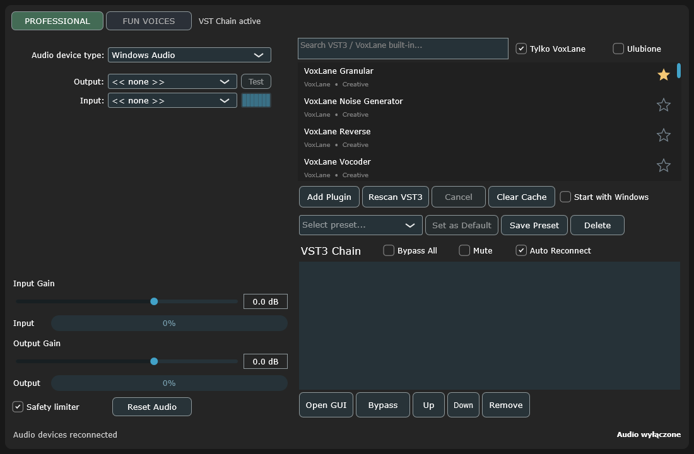
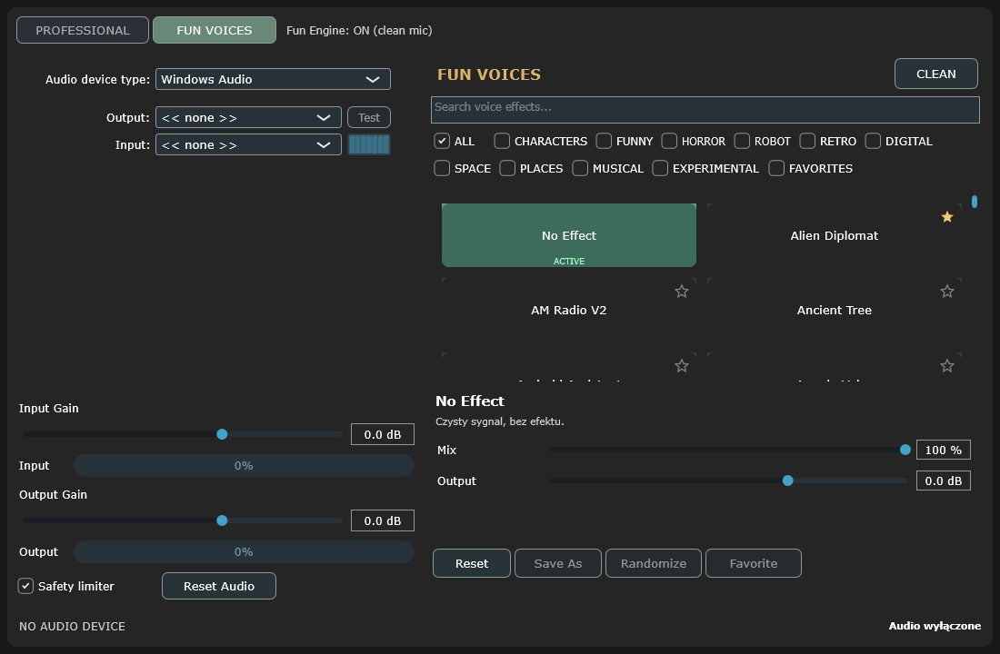

# VoxLane — Beta 0.7

VoxLane is a portable real-time VST3 microphone host and audio processor for Windows, built with C++ and JUCE.

Process your microphone with external VST3 plugins, VoxLane's built-in processors or 100 Fun Voices, then send it to your chosen output or a virtual audio cable.

## Download

[Download VoxLane Beta 0.7](https://github.com/Reekksio/VST-MIC-HOST-VoxLane-/releases/download/v0.7/VoxLane-Beta-0.7.zip) · [Release notes](https://github.com/Reekksio/VST-MIC-HOST-VoxLane-/releases/tag/v0.7)

Extract the ZIP and run **VST Mic Host Beta.exe**. Keep `VSTScanner.exe`, `voxlane-public.json` and `ThirdParty` beside it. No installation is required.

An account and an internet connection are required to sign in and verify Pro access. Sign in once; the session is saved in Windows Credential Manager without storing your password.

## Free and Pro

**VoxLane Pro costs PLN 25 once and is linked to your account. There is no subscription. This release uses real Stripe payments.** Buy Pro from Account in the app; access refreshes automatically after payment verification.

- Free: external VST3 hosting, safety limiter, Compressor, High Pass, Low Pass, Parametric EQ, Low Shelf, High Shelf and Noise Gate.
- Pro: the remaining VoxLane built-in plugins, editable Fun Voice macros and custom User voice presets.
- All accounts can use the 100 factory Fun Voices with their standard settings.

Test purchases and live purchases have separate entitlements. A sandbox purchase does not unlock this live release.

## Screenshot

## Features

- VST3 scanning, plugin editors, reordering and bypass
- 28 visible VoxLane built-in plugins with their own editors
- 100 Fun Voices in 10 categories; search and favourites
- A/B comparison, Undo/Redo and reset in built-in plugin editors
- Actual compressor gain-reduction metering
- Favourite plugins and a VoxLane-only filter
- Microphone/output selection, sample rate, buffer size and gain controls
- Preset saving/loading and a safety limiter
- Automatic device reconnection; None remains selected when chosen
- Approximate audio latency display
- Polish and English account interface
- Close to Windows tray; double-click the tray icon to reopen
- Optional start with Windows

Fun Voices starts at **CLEAN / No Effect**. Pitch/formant and layered-voice processing add algorithmic latency; total latency also depends on the device buffer and plugin chain.

## Discord, OBS and other applications

Use a virtual audio cable such as [VB-CABLE](https://vb-audio.com/Cable/):

1. Select your microphone as VoxLane's input.
2. Select **CABLE Input** as VoxLane's output.
3. Configure your processing chain or choose a Fun Voice.
4. Select **CABLE Output** as the microphone in Discord, OBS or another application.

`Microphone → VoxLane → VB-CABLE → Discord / OBS / Game`

The device test tone tests the output directly. If it plays but your microphone is silent, check the selected microphone, its active channel and VoxLane's **Mute** control.

## Project status

VoxLane is under development. Beta 0.7 is a prerelease; report reproducible issues through GitHub Issues.

This repository contains downloads, screenshots and the public account website. The application's C++ source is not public.
