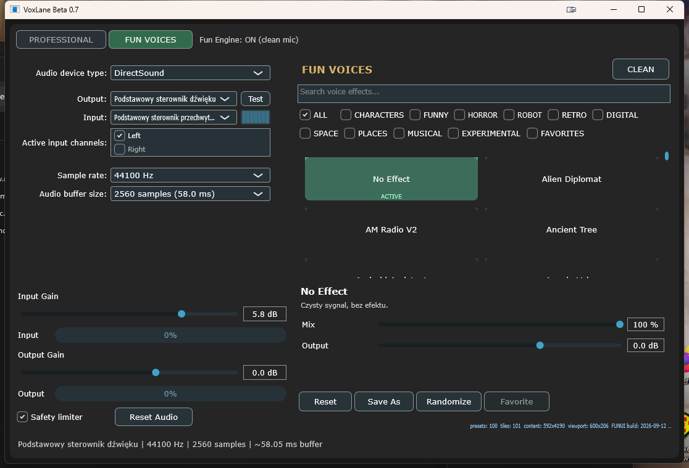

# VoxLane Beta 0.7

VoxLane is a portable real-time VST3 microphone host and audio processor for Windows, built with C++ and JUCE.

Process your microphone through a customizable VST3 plugin chain in **Professional** mode, or use **Fun Voices** with 100 built-in voice effects. Send the processed signal to a selected audio output for use with Discord, OBS, games and other applications.

No installation is required for VoxLane itself. Extract the ZIP and run `VST Mic Host Beta.exe`. Keep `VSTScanner.exe` and the `ThirdParty` folder alongside it.

**[Download VoxLane Beta 0.7](https://github.com/Reekksio/VST-MIC-HOST-VoxLane-/releases/tag/v0.7)**

## Screenshots

### Professional — VST3 plugin chain

### Fun Voices — built-in voice effects

## Features

### Professional

- VST3 plugin scanning and loading
- Custom VST3 processing chain
- Plugin reordering and bypass
- Plugin GUI support
- VST preset saving and loading

### Fun Voices

- 100 factory presets using built-in DSP, without external VST3 plugins
- 10 categories: Characters, Funny, Horror, Robot, Retro, Digital, Space, Places, Musical and Experimental
- Pitch and formant shifting, layered voices, reverse effects, modulation, distortion, delay and reverb
- 263 adjustable preset macros, plus Mix and Output controls
- Preset search, favorites, randomization and reset
- Save a modified factory preset as your own User preset
- CLEAN / No Effect for an unprocessed microphone signal; Fun starts with CLEAN

### Audio and portability

- Input and output device selection
- Sample rate and buffer size configuration
- Active input channel selection
- Input and output gain controls
- Safety limiter
- Automatic audio reconnection
- Start with Windows option
- Portable — no installation required for the application

## Using VoxLane with a Virtual Audio Cable

To use the processed microphone signal in Discord, OBS, games or other applications, connect VoxLane to a virtual audio cable such as [VB-CABLE Virtual Audio Device](https://vb-audio.com/Cable/).

### Setup

1. Install VB-CABLE.
2. Extract the VoxLane ZIP and open `VST Mic Host Beta.exe`.
3. Select your physical microphone as the input device.
4. Select `CABLE Input` as the output device.
5. Choose **Professional** and configure your VST3 chain, or choose **Fun Voices** and select a built-in effect.
6. In Discord, OBS, a game or another application, select `CABLE Output` as the microphone/input device.

Audio routing:

`Microphone → VoxLane (Professional / Fun Voices) → VB-CABLE → Discord / OBS / Game`

The receiving application gets the microphone signal after processing by VoxLane.

## Beta 0.7 notes

- Pitch/formant and layered-voice presets add approximately **123 ms of DSP latency**, in addition to the audio device buffer. Other effects have approximately 3 ms of limiter latency plus their intentional echoes or reverberation. CLEAN bypasses Fun DSP.
- Debug and Release builds passed DSP and preset tests. Effect character and sound quality can vary with the speaker's voice and settings.
- Beta settings and User presets are stored separately under `%APPDATA%\VSTMicHostBeta`.
- The portable executable retains the filename `VST Mic Host Beta.exe` for compatibility with existing shortcuts.
- Signalsmith Stretch and Linear are used under the MIT license; license files are included in `ThirdParty`.

## Planned improvements

- Further listening tests and tuning across different voices
- More built-in processing options and preset controls
- Additional audio processing and routing features

## Open Source

VoxLane is currently under development. The project is planned to become open source in the future.

This repository currently provides project information, screenshots and downloadable releases.
