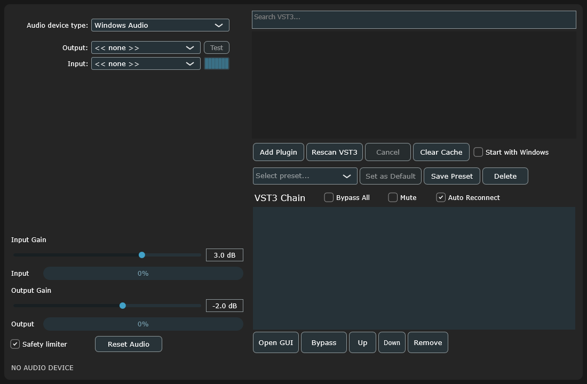

# VoxLane 0.5 — reconstructed source edition

This is a reconstruction of the legacy Windows VST3 microphone host. The original 0.5 source snapshot was not retained. These sources were recovered from the retained host code with later product features removed; they are not claimed to reproduce the original 0.5 binary byte for byte.

The application routes a microphone through external VST3 plugins to an audio output. It includes scanning in a separate process, plugin editors, chain ordering and bypass, VST presets, device selection, input/output gains and meters, a safety limiter, audio reconnection, Windows startup and a tray menu.

This edition has no built-in VoxLane effects, Fun Voices, account system, licensing checks or payments. It does not require an account or an internet connection at runtime. Download and keep `VSTScanner.exe` beside `VoxLane 0.5.exe`.



## Build on Windows

Install Visual Studio 2019 or 2022 Build Tools with Desktop development with C++, a Windows SDK, Git, and CMake 3.22 or newer.

```powershell
cmake -S . -B build -G "Visual Studio 17 2022" -A x64
cmake --build build --config Release --target VoxLane VSTScanner
```

CMake downloads JUCE 8.0.8. Build outputs are `build/VoxLane_artefacts/Release/VoxLane 0.5.exe` and `build/VSTScanner_artefacts/Release/VSTScanner.exe`. A local JUCE 8.0.8 checkout can be supplied through `-DFETCHCONTENT_SOURCE_DIR_JUCE=C:/path/to/JUCE`.

For Visual Studio 2019, replace the generator with `Visual Studio 16 2019`. The release was built with MSVC 19.29 on Windows x64.

## Use

Choose the microphone input and audio output, scan VST3 plugins, and add plugins to the chain. To feed Discord or OBS, use a virtual audio cable as the output and choose its recording endpoint in the receiving application.

Closing the window keeps audio running in the system tray. Double-click the tray icon to reopen; right-click and choose Quit to exit. `--tray` starts the window hidden. Settings use the legacy `%APPDATA%/VSTMicHost` folder and may be shared with an older installation.

## License

The retained project license is in [LICENSE](LICENSE). JUCE has its own licensing terms; see [THIRD_PARTY_NOTICES.md](THIRD_PARTY_NOTICES.md). VST3 plugins are external software and are not distributed here.
